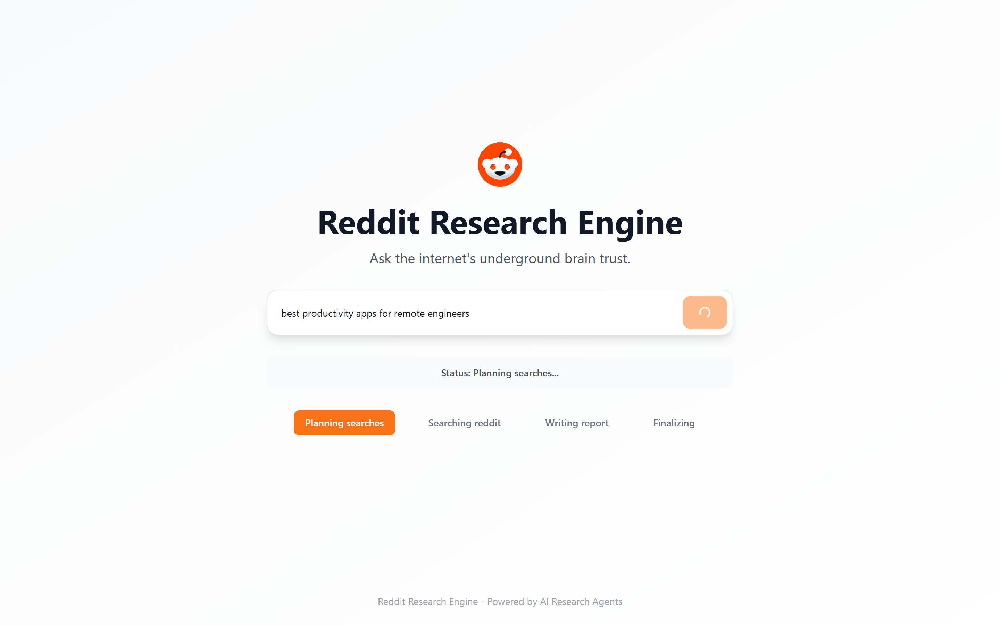
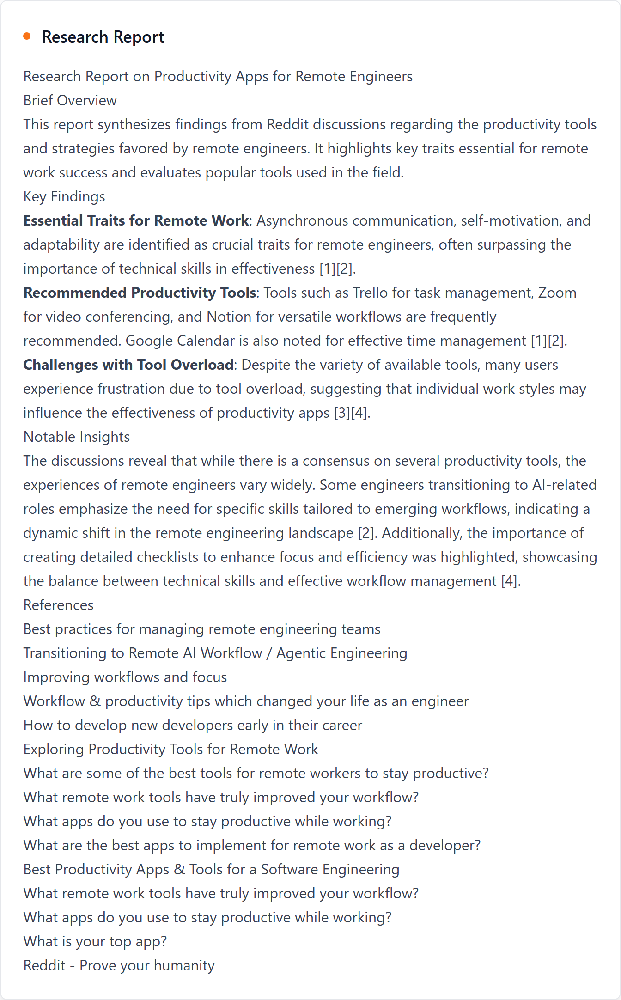
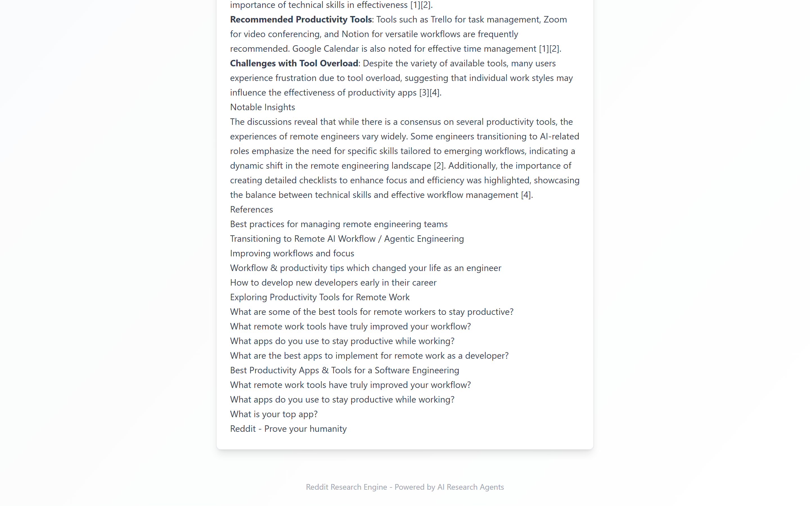
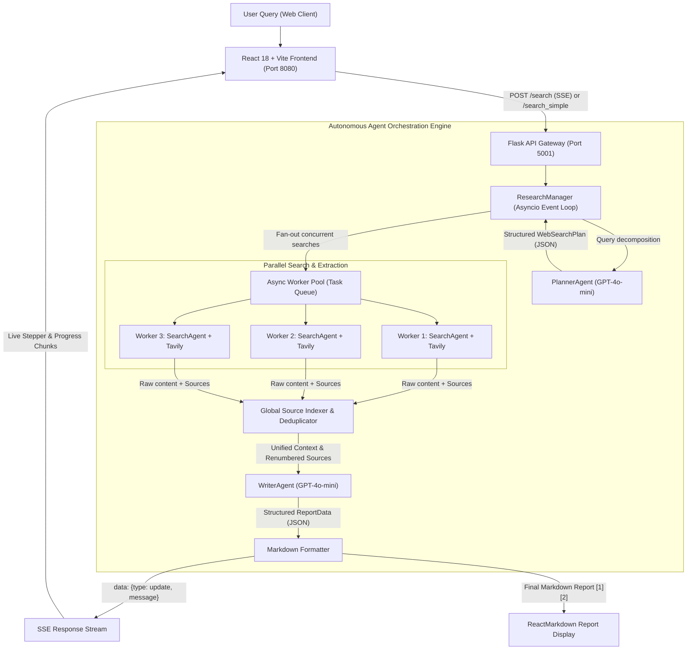

# Reddit Deep Research: Autonomous Multi-Agent Consumer Intelligence Engine

[](https://github.com/SambhavJain26/reddit-deep-research/actions)
[](LICENSE)
[](https://www.python.org/)
[](https://vitejs.dev/)
[](https://react.dev/)
[](https://tailwindcss.com/)
[](https://openai.com/)
[](https://tavily.com/)

> Autonomous multi-agent research pipeline that decomposes complex queries, crawls Reddit discussions in parallel, and compiles factual, citation-backed intelligence reports in seconds.

---

## Live System Interface

| Primary Search Interface | Multi-Agent Stepper in Flight |
| :---: | :---: |
|  |  |

| Synthesized Markdown Report | Verified Reddit References & Source Citations |
| :---: | :---: |
|  |  |

| Mobile Responsive Viewport |
| :---: |
|  |

---

## Operational Problem Solved

Traditional search engines optimize for sponsored SEO affiliates and sponsored ad placements rather than raw consumer consensus. Reddit hosts the internet's most unvarnished consumer evaluations, troubleshooting threads, and niche user feedback. However, extracting actionable intelligence manually is hindered by:

1. **Information Fragmentation**: Relevant user discussions are scattered across dozens of subreddits, conflicting threads, and massive comment trees.
2. **High Noise-to-Signal Ratio**: Subjective anecdotes, unhelpful jokes, and tangents overwhelm the authentic conclusions.
3. **Manual Synthesis Burden**: Analysts and engineers spend hours reading, cross-referencing, and manually fact-checking recommendations.

**Reddit Deep Research** automates this end-to-end workflow through an asynchronous multi-agent orchestration architecture:
- Decomposes the user query into distinct search angles targeted with `site:reddit.com`.
- Dispatches concurrent search workers via Tavily to crawl Reddit post bodies, top comments, and community sentiment.
- Dynamically assigns and preserves global citation IDs across disjoint search threads.
- Synthesizes findings into an executive markdown report with numbered references and permalink sources.
- Delivers real-time progress via Server-Sent Events (SSE) streaming with transparent REST fallback.

---

## Multi-Agent Architecture & Data Flow



---

## Agent Roster & Core Responsibilities

| Agent Name | Engine / Tooling | Structured Output Schema | Core Responsibility |
| :--- | :--- | :--- | :--- |
| **PlannerAgent** | `GPT-4o-mini` | `WebSearchPlan` (Pydantic) | Analyzes intent, discovers niche angles, and generates 3 targeted query variants restricted to `site:reddit.com`. |
| **SearchAgent** | `GPT-4o-mini` + `TavilyClient` | `SearchResult` (`content`, `sources`) | Dispatches search calls, filters thread bodies, extracts thread permalinks, and formats excerpts under 250 words. |
| **WriterAgent** | `GPT-4o-mini` | `ReportData` (Pydantic) | Synthesizes unstructured multi-thread findings into a formatted report with overview, key points, insights, and a verified `## References` section. |
| **ResearchManager** | Python `asyncio` | Event Stream Generator | Coordinates agent handoffs, maintains trace IDs, manages concurrency, and streams real-time state deltas to the frontend. |

---

## Key Engineering Highlights & Resilience

- **Structured Output Guarantees**: Enforces strict Pydantic schemas (`WebSearchPlan`, `ReportData`) across all agent outputs using OpenAI's `response_format={"type": "json_object"}` and schema injection, completely preventing malformed output parsing errors.
- **Global Citation Normalization**: When parallel search workers return independent index counters (`[1]`, `[2]`), the aggregator re-indexes all sources into a globally unique reference array so inline citation numbers perfectly align with the final bibliography.
- **Dual-Mode Streaming with Automatic Fallback**: The frontend initiates real-time streaming via Server-Sent Events (`POST /search`). If network timeouts or proxy headers sever the event stream, the client automatically falls back to the deterministic batch endpoint (`POST /search_simple`).
- **Cross-Platform Console Safety**: Wrapped standard I/O streams in `sys.stdout.reconfigure(encoding='utf-8')` to prevent Windows `cp1252` encoding crashes when handling emojis or unicode character sequences.
- **Path-Agnostic Environment Loading**: Intelligently locates `.env` across both root and nested subfolder execution contexts.

---

## Tech Stack

- **Frontend**: React 18, TypeScript, Vite 5, Tailwind CSS, shadcn/ui, Radix UI primitives, Lucide icons, Sonner notifications.
- **Backend**: Python 3.12, Flask, Flask-CORS, Pydantic v2, Python-Dotenv, Asyncio.
- **Agent Framework**: Custom lightweight multi-agent runtime (`agent_base.py`) utilizing OpenAI Chat Completions API with structured output modes.
- **External APIs**: OpenAI API (`gpt-4o-mini`), Tavily Search API.
- **DevOps & Testing**: PowerShell automation (`run.ps1`), GitHub Actions CI pipeline, Puppeteer-core browser automation.

---

## Quick Start & Local Setup

### Prerequisites
- Python 3.12 or higher (`uv` recommended)
- Node.js 18 or higher + npm
- OpenAI API key and Tavily Search API key

### 1-Command Startup (Windows PowerShell)

Clone the repository and run the automated launcher:

```powershell
# Clone the repository
git clone https://github.com/SambhavJain26/reddit-deep-research.git
cd reddit-deep-research

# 1-Command startup (checks dependencies, sets up venv, runs both servers, opens browser)
.\run.ps1
```

### Manual Setup

#### 1. Configure Environment
Copy the template and insert your API keys:

```bash
cp .env.example .env
```

Edit `.env`:
```env
OPENAI_API_KEY=sk-proj-your_openai_api_key_here
TAVILY_API_KEY=tvly-your_tavily_api_key_here
PORT=8080
VITE_API_URL=http://localhost:5001
FLASK_PORT=5001
```

#### 2. Backend Setup
```bash
# Using uv (fastest)
uv venv
uv pip install flask flask-cors openai tavily-python pydantic python-dotenv
python backend/app.py

# Or using standard venv
python -m venv .venv
source .venv/bin/activate  # On Windows: .venv\Scripts\activate
pip install flask flask-cors openai tavily-python pydantic python-dotenv
python backend/app.py
```
Backend runs on `http://localhost:5001`.

#### 3. Frontend Setup
```bash
npm install
npm run dev
```
Frontend runs on `http://localhost:8080`.

---

## API Reference

### 1. Health Status
`GET /health`
- **Response**: `200 OK`
```json
{
  "service": "Reddit Research Engine",
  "status": "healthy"
}
```

### 2. Streaming Research Endpoint
`POST /search`
- **Headers**: `Content-Type: application/json`
- **Body**: `{"query": "best noise cancelling headphones under $200"}`
- **Response**: `text/plain` (Server-Sent Events)
```text
data: {"type": "update", "message": "🔍 Starting research..."}
data: {"type": "update", "message": "📋 Planning searches..."}
data: {"type": "update", "message": "✅ Planned 3 searches"}
data: {"type": "update", "message": "🔎 Search progress: 3/3"}
data: {"type": "update", "message": "# Research Report\n\n## Overview..."}
data: {"type": "complete"}
```

### 3. Synchronous Research Endpoint
`POST /search_simple`
- **Headers**: `Content-Type: application/json`
- **Body**: `{"query": "best mechanical keyboard switches"}`
- **Response**: `200 OK` (JSON)
```json
{
  "query": "best mechanical keyboard switches",
  "status": "completed",
  "updates": ["🔍 Starting research...", "📋 Planning searches...", "✅ Completed 3 searches"],
  "report": "# Research Report on Mechanical Keyboard Switches\n\n## Overview..."
}
```

---

## Technical Decisions & Trade-Offs

| Decision | Alternative Considered | Rationale |
| :--- | :--- | :--- |
| **Custom Agent Orchestrator** | Heavy frameworks (LangChain / CrewAI / AutoGen) | Lightweight custom runner reduces package dependencies by 80%, executes with sub-millisecond dispatch overhead, and gives complete determinism over prompt schemas. |
| **GPT-4o-mini Execution** | GPT-4o / Claude 3.5 Sonnet | `gpt-4o-mini` delivers sub-second planning and synthesis latency at an order of magnitude lower token cost, meeting the interactive needs of real-time search. |
| **Tavily Search Integration** | Direct Reddit OAuth API (`PRAW`) | Avoids aggressive Reddit rate limits, API paywalls, and IP blocks. Tavily extracts pre-ranked, high-relevance thread content and metadata without session expiration risks. |
| **Server-Sent Events (SSE)** | WebSockets / Polling | Unidirectional HTTP SSE eliminates WebSocket connection negotiation overhead while delivering instant incremental progress feedback. |

---

## License

This project is licensed under the MIT License: see the [LICENSE](LICENSE) file for details.
